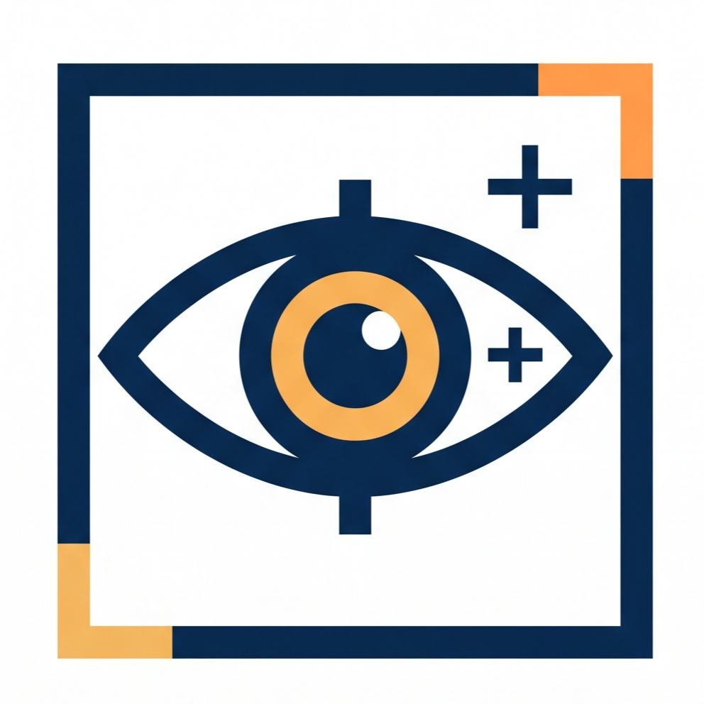

# Vision Image Tool



Phần mềm Windows hỗ trợ kiểm thử hệ thống AI Vision **UnitX**: đẩy ảnh / chụp camera qua UnitX SDK, nhận kết quả OK/NG, và quản lý dataset ảnh Raw/Mask để lập báo cáo test.

## Tính năng chính

### Capture & Monitor
- Kết nối UnitX qua SDK: kiểm tra mạng (gRPC / Blob / ZMQ), trạng thái hệ thống, cấu hình Production.
- **Push ảnh** từ thư mục sang UnitX, tự lưu ảnh Mask kết quả cạnh ảnh gốc.
- **Trigger camera** (một ảnh / lặp / liên tục), lưu ảnh Raw + Mask kèm kết quả OK/NG.
- Đo thời gian từng chặng (push, xử lý, truyền ảnh, hiển thị) để tìm điểm nghẽn, xuất CSV.

### Dataset Manager
- Đọc dataset theo **schema** do người dùng định nghĩa, theo tên file và/hoặc cấp thư mục, ví dụ:
  `<ĐK>\<Raw/Mask>\<Model>\<Mã NG>\<SPL>\<Bỏ qua>_<Đánh giá>.<Extension>`
- Ghép cặp Raw ↔ Mask, nhiều điều kiện chụp (ĐK), nhiều lần chụp trên một hàng.
- So sánh **Vision** (kết quả AI) với **Đánh giá** (nhãn của người kiểm), thống kê O / Δ / X.
- Phát hiện vấn đề dữ liệu: thiếu Mask/Raw, sai schema, trùng mẫu, file ảnh hỏng.
- Xuất báo cáo **Excel** (kèm ảnh thumbnail) và **JSON**.

## Yêu cầu

- Windows 10/11 x64, .NET Framework 4.8
- Visual Studio 2022 trở lên (workload *.NET desktop development*)
- Thư viện UnitX SDK (`unitx_sdk.dll`, `unitx_sdk_interface.dll`) và `Basler.Pylon.dll`: **không có trong repo**, cần chép vào thư mục chạy (`Vision Image Tool\bin\<Configuration>\`).

## Build & chạy

1. Clone repo và mở `VisionImageTool.sln` bằng Visual Studio.
2. Chuột phải Solution → **Restore NuGet Packages**.
3. Chép các DLL của UnitX SDK / Basler vào thư mục output.
4. Chọn cấu hình **Debug** hoặc **Release | x64** → **Build** → chạy.

Cấu hình và log của phần mềm lưu tại thư mục `pushv13` cạnh file exe.

## Kiểm thử

Bộ test hồi quy không cần phần cứng (không kết nối UnitX / camera): kiểm tra schema, đọc dataset, phát hiện file ảnh hỏng, dựng giao diện.

```powershell
.\tests\run-regression.ps1 -Exe "Vision Image Tool\bin\Debug\Vision Image Tool.exe"
# So sánh với một bản build cũ:
.\tests\run-regression.ps1 -Exe "<bản mới>.exe" -BaselineExe "<bản cũ>.exe"
```

## Tài liệu

- [Hướng dẫn lập báo cáo test AVI](docs/n-hd-nmiavitest-01-huong-dan-lap-bao-cao-test-avi.pdf)
- [Hướng dẫn sử dụng phần mềm](docs/huong-dan-su-dung-phan-mem.pdf)
- [Lưu đồ xử lý dataset](docs/luu-do-xu-ly-dataset.pdf)
